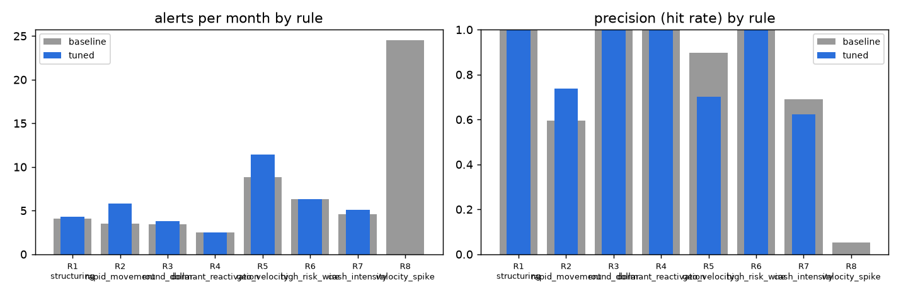

# aml-transaction-monitoring

A rules-based AML transaction-monitoring engine of the kind a bank's BSA/AML operations team runs every night, built
end to end on a **synthetic, fully labelled** retail-bank dataset so that every alert can be graded as a true hit or a
false positive:

1. a generator that writes 518,492 transactions for 2,000 customers over 12 months and injects six
   money-laundering typologies on 190 of them (structuring, rapid movement, round-dollar, dormant-then-active,
   geographic velocity, high-risk wires);
2. eight scenario rules written in **SQL and run in DuckDB**, with every threshold in `config.yaml`;
3. alert scoring and prioritisation (rule weight x severity + customer risk + multi-rule bonus -> high / medium / low);
4. a **false-positive analysis and threshold tuner** that spends a fixed monthly analyst budget on the alerts most likely to be real;
5. SAR-style case summaries (template, no LLM) for the top cases;
6. a Power BI-ready star schema (7 CSV tables) and a notebook with alert volume, hit rate and FP rate by rule.

Every number in this README is written by `python run.py` into `results/` (`metrics.json`, `rule_summary_*.csv`,
`tuning_selection.csv`); the tables below are generated from those files.

## Problem

Transaction monitoring is where most AML cost goes: rules fire, analysts review, and typically well over 90 % of
alerts are closed as non-suspicious. Two things decide whether a program works - whether the rules can see the
typologies the bank is exposed to, and whether the alert volume matches the team that has to work it. This project
makes both measurable: because the data is synthetic and labelled, precision and recall per rule are exact.

## Data (synthetic, `aml/generate.py`)

- 2,000 customers (80 % individuals, 20 % businesses) with a risk rating, occupation, home country and a declared
  *expected monthly volume*; 1-2 accounts each across 40 branches.
- Baseline activity drawn per customer from a Poisson/log-normal mix over nine transaction types (cash, wires, ACH,
  card, ATM, cheques) with mostly domestic counterparties.
- Injected typologies (`typology` column on each injected row, `suspicious_typology` on the customer):

| typology | customers | how it is injected |
|---|---|---|
| structuring | 40 | 3-6 cash deposits of $8,200-$9,900 within 5 days, spread over branches |
| rapid_movement | 35 | wire/ACH in of $25k-$150k, then 60-100 % wired out within 2-48 h in 1-3 transfers |
| round_dollar | 30 | 5-9 transfers of exactly $5k / $10k / ... / $50k inside a month |
| dormant_reactivation | 30 | 100-160 days with no activity, then 4-8 transactions of $4k-$30k in a week |
| geo_velocity | 30 | 2-4 pairs of card/ATM transactions in two countries 0.5-4 h apart |
| high_risk_wires | 25 | 2-4 outbound wires of $6k-$60k to countries on the high-risk list |

The generator is seeded (`generator.seed`), so `python run.py` reproduces the dataset exactly.

## Rules (`sql/*.sql`, run in DuckDB)

| rule | logic (baseline thresholds) |
|---|---|
| R1 structuring | >= 3 cash deposits in [$8,000, $10,000) within 7 days |
| R2 rapid movement | inbound >= $20,000 followed within 3 days by outbound >= 80 % of it |
| R3 round dollar | >= 4 transfers that are exact multiples of $1,000 and >= $5,000 within 30 days |
| R4 dormant reactivation | >= 90 days silent, then >= $15,000 within 7 days |
| R5 geo velocity | two card/ATM transactions >= $100 in different countries within 6 hours |
| R6 high-risk wire | outbound wire >= $5,000 to a high-risk jurisdiction |
| R7 cash intensity | monthly cash deposits >= $20,000 and >= 3x the declared expected volume |
| R8 velocity spike | 7-day transaction count >= 4x the customer's trailing 90-day baseline (and >= 15) |

Each rule returns the same alert schema (customer, rule, date, trigger amount, transaction ids, one-line detail), so
rules can be added by dropping a SQL file and a config block.

## Results

### Baseline thresholds - 693 alerts in 12 months (57.8/month), precision 53%, 175/190 suspicious customers alerted

*precision* = share of a rule's alerts on a customer injected with the typology that rule targets; *fp_rate* = share of
alerts on customers with no injected typology at all; *recall* = share of that typology's injected customers the rule alerted.

| rule_id | alerts | alerts_per_month | precision | fp_rate | recall |
|---|---|---|---|---|---|
| R1_structuring | 49 | 4.1 | 100% | 0% | 100% |
| R2_rapid_movement | 42 | 3.5 | 60% | 12% | 54% |
| R3_round_dollar | 41 | 3.4 | 100% | 0% | 100% |
| R4_dormant_reactivation | 30 | 2.5 | 100% | 0% | 100% |
| R5_geo_velocity | 106 | 8.8 | 90% | 8% | 100% |
| R6_high_risk_wire | 76 | 6.3 | 100% | 0% | 100% |
| R7_cash_intensity | 55 | 4.6 | 69% | 2% | 92% |
| R8_velocity_spike | 294 | 24.5 | 5% | 85% | 23% |

### Tuned to an analyst budget of 40 alerts/month - 470 alerts (39.2/month), precision 83%, 190/190 suspicious customers alerted

| rule_id | param | value | alerts_per_month | precision | recall | reason |
|---|---|---|---|---|---|---|
| R1_structuring | min_count | 2 | 4.3 | 100% | 100% | loosest setting above the precision floor (max recall) |
| R2_rapid_movement | min_out_share | 0.6 | 5.8 | 74% | 100% | tightened to fit analyst capacity |
| R3_round_dollar | min_count | 3 | 3.8 | 100% | 100% | loosest setting above the precision floor (max recall) |
| R4_dormant_reactivation | min_burst_amount | 5000 | 2.5 | 100% | 100% | loosest setting above the precision floor (max recall) |
| R5_geo_velocity | max_hours | 24 | 11.4 | 70% | 100% | loosest setting above the precision floor (max recall) |
| R6_high_risk_wire | min_amount | 1000 | 6.3 | 100% | 100% | loosest setting above the precision floor (max recall) |
| R7_cash_intensity | min_monthly_cash | 15000 | 5.1 | 62% | 92% | tightened to fit analyst capacity |
| R8_velocity_spike | multiple | 6 | 0.0 | 6% | 20% | never reaches precision 15% at any threshold - disabled pending redesign |

Priority mix after tuning: high 293, medium 133, low 44. The top 25 customers by score get a case file in `results/cases/`.



## Key decisions

- **Labelled synthetic data instead of a public "AML dataset".** There is no public dataset with real SAR outcomes;
  the popular Kaggle ones are themselves synthetic without documented typologies. Generating the data here makes the
  ground truth explicit and the FP analysis exact. The price: rules look better than they would on real data (see limitations).
- **SQL in DuckDB, not pandas.** Monitoring rules at banks live in SQL (Actimize, Mantas, SAS, in-house). Writing them
  as parameterised SQL files keeps them readable by compliance staff and testable in isolation
  (`tests/test_rules.py` renders every rule and checks no placeholder is left unfilled).
- **Tuning spends a budget, it doesn't chase a metric.** `aml/tuning.py` starts every rule at its loosest setting that
  clears a precision floor (15 %), then tightens one step at a time the rule whose marginal alerts contain the fewest
  hits, until the monthly volume fits the analyst capacity. A rule that never reaches the floor is *disabled pending
  redesign* rather than tuned - which is exactly what happened to R8 (velocity spike): 85 % of its baseline alerts were on
  clean customers, and it was eating 24 of the 58 baseline alerts per month.
- **Precision floor + recall floor together.** Without the recall floor the tuner would silently switch off coverage of a
  typology to save volume; without the precision floor it would keep a rule that only generates work.
- **Severity is logarithmic in amount.** A $50k structuring episode outranks a $25k one, but not by 2x - analysts
  triage by pattern first, size second.

## Limitations

- The rules were written by the same person who injected the typologies, so recall is near-perfect on the injected
  cases. Real typologies mutate; real recall is unknowable without SAR feedback loops. The FP rates are the more honest
  number here, because false positives come from the *baseline* population the rules were not written against.
- Customer risk ratings and expected volumes are generated, not KYC-derived; the risk-rating bonus in scoring is a
  placeholder for a real KYC risk model.
- No network / counterparty analysis (mule networks, funnel accounts) and no sanctions screening - both are separate
  systems in practice.
- The SAR template produces a first draft of the narrative structure; a real SAR requires investigator judgement and
  is filed on FinCEN's form, not markdown.

## How to run

```bash
git clone https://github.com/lukefreyman-ai/aml-transaction-monitoring && cd aml-transaction-monitoring
make setup       # venv + pip install -r requirements.txt
make run         # ~20 s: generate data -> rules -> score -> tune -> cases -> star schema -> results/
make test        # 9 tests on a 40k-row config (~4 s)
make notebook    # executes notebooks/alerts_analysis.ipynb against results/
make quick       # 60k rows / 400 customers, no tuning
```

`results/star_schema/*.csv` loads straight into Power BI (`fact_alert` -> `dim_rule`, `dim_customer`, `dim_date`;
`bridge_alert_txn` -> `fact_transaction`). `results/tuned_thresholds.yaml` is the config the tuner recommends.

## Repo layout

```
run.py                 pipeline entry point
config.yaml            generator, rule thresholds + tuning grids, scoring weights, analyst budget
sql/R1..R8_*.sql       scenario rules (DuckDB SQL with {placeholders})
aml/generate.py        synthetic customers / accounts / transactions with injected typologies
aml/rules.py           renders + runs the SQL, common alert schema
aml/scoring.py         scoring, priority bands, ground-truth labelling, per-rule summary
aml/tuning.py          threshold sweep + budget-driven selection
aml/case.py            SAR-style case summaries
aml/export.py          star-schema CSV export
notebooks/             alerts_analysis.ipynb (executed)
tests/                 generator determinism, rule schema/recall, scoring, tuning, case + export
results/               alerts, rule summaries, tuning sweep/selection, cases/, metrics.json
```
